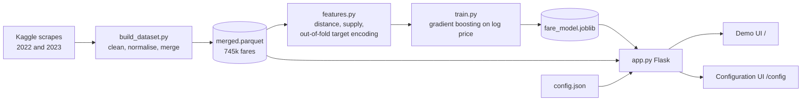

# Flight Fare Predictor

A proof of concept that predicts Indian domestic airfares and compares them with the fare listed today, wrapped in a MakeMyTrip-style search demo and a configuration page that explains every metric.

**The idea.** A booking platform lists a fare today. If a model can estimate what that flight will cost closer to departure, the platform can show both prices side by side and decide when to offer a better one. This repository is the end-to-end prototype: data merge, model, evaluation and a small web app.

> **Status: working prototype, honest numbers.** Held-out accuracy is **93.0%** when the period is known, **87.0%** with a small recent sample, and **66.2%** for a period the model has never seen. The 95% target is **not** reached on this data, and the reasons are documented below. No synthetic data is used anywhere.

---

## Contents
- [Demo](#demo)
- [Results](#results)
- [How the score was reached](#how-the-score-was-reached)
- [Why it is not 95% yet](#why-it-is-not-95-yet)
- [Quick start](#quick-start)
- [How it works](#how-it-works)
- [Project layout](#project-layout)
- [HTTP API](#http-api)
- [Data and licences](#data-and-licences)
- [Roadmap](#roadmap)

---

## Demo

Two pages, served by Flask on `http://localhost:5055`.

**`/` Demo**
- Search by origin, destination, travel date and cabin class.
- Each flight shows the **listed price** (the real scraped fare for that flight near the booking window), the **predicted price** and the percentage change. Changes above a threshold are highlighted.
- **10 flights per page** with page numbers, plus filters (airline, stops) and sorting (listed, predicted, biggest drop, biggest rise, airline).
- An **Approve** button per flight (and "approve all on this page") strikes through the listed price and keeps the predicted one.
- **Details** on any flight shows the predicted-price curve by days before departure and a table of **the exact parameters the model received**: airline, route, departure hour, distance, days before departure, weekday, route supply, the typical price level of that flight, and so on.

**`/config` Configuration & metrics**
- **Settings** saved to `config.json`: prediction horizon (1 to 45 days), 2022 or 2023 price level, listed-price window, highlight threshold, default sort, curve points.
- **Metrics:** the three held-out scores and what each test means.
- **How we got the score:** the measured path from 86.9% to 93.0%, feature by feature, plus a feature-importance chart.
- **Model & parameters:** algorithm, all hyperparameters, all 18 features with descriptions.
- **Data & sources:** per-period counts, every dataset with used or not-used status, cleaning rules and assumptions.

## Results

Accuracy is `100 − MAPE`: the average of `|predicted − actual| / actual` over rows the model never trained on.

| Test | Setup | Accuracy | Within ±10% | Avg. miss |
|---|---|---|---|---|
| **Same period** | Random 20% of the 2023 rows held out | **93.0%** | 77.6% | ₹1,500 |
| **Recalibrated** | Train on 2022 plus 10% of 2023 flight-days, test on the other 90% | **87.0%** | 55.1% | ₹2,717 |
| **Unseen period** | Train on 2022 only, test on all of 2023 | **66.2%** | 19.9% | ₹5,889 |

Read these in order of how realistic they are for forecasting. The first is an interpolation score (other days of the same flights are in training). The last is the honest test of predicting a period the model has never seen.

## How the score was reached

Every number below was measured in this project; the full log is in [`models/experiments.json`](models/experiments.json).

**Step 1. Add real signal, one feature at a time** (model size fixed at 400 rounds):

| Features | Same period | Recalibrated |
|---|---|---|
| Basic: airline, route, class, stops, duration, time bucket, days left, weekday, month | 86.9% | 82.2% |
| + period (which scrape) | 86.9% | 82.9% |
| + exact departure/arrival hour + route distance | 88.7% | 84.7% |
| + route supply (flights per route and class) | 88.8% | 84.9% |
| + per-flight price level (out-of-fold target encoding) | 89.6% | 84.7% |
| + per-route-airline price level | 89.6% | 84.9% |

The exact departure and arrival times were hiding in the raw scraped file. Recovering them was a cheap and real gain.

**Step 2. Make the model bigger and tune it** (same-period test):

| Setting | Accuracy |
|---|---|
| 400 rounds, learning rate 0.08, 63 leaves | 89.6% |
| 1,200 rounds, 0.05, 127 leaves, L2 = 1 | 91.4% |
| 2,000 rounds, 0.04, 255 leaves, min leaf 10, L2 = 1 | 92.4% |
| **3,500 rounds, 0.05, 255 leaves, min leaf 5, L2 = 1 (final)** | **93.0%** |

The final model stopped at the 3,500-round cap while still improving, so a little more is available with diminishing returns.

**What the model relies on** (permutation importance, accuracy points lost when a feature is shuffled):

| Feature | Points |
|---|---|
| `te_flight` (typical price of this flight code and class) | 70.8 |
| `te_route_airline` (typical price of this airline on this route) | 19.5 |
| `days_left` | 10.9 |
| `duration_h` | 10.8 |
| `destination` | 4.8 |

> **Read this carefully.** The importance run used rows the shipped model trained on, and the target-encoded features use the full training set, so treat it as a ranking of what the model uses, not as out-of-sample effect sizes. It still shows that the score leans heavily on already knowing a flight's typical fare. That is fine for flights seen in training and would generalise less well to brand-new flights.

## Why it is not 95% yet

- **Each scrape is a single day.** The model sees a flight's price once and never sees it move, so it cannot learn repricing behaviour or festival effects. Journey date and days-left are also the same signal inside one scrape.
- **The 2022 and 2023 price levels differ a lot.** Economy fares are about 55% higher in the 2023 scrape (median about ₹9,500 against about ₹5,800 in 2022), which caps the unseen-period score.
- **The remaining error is not label noise.** With exact times, only 1.5% of rows share an itinerary-day with a different price. The leftover error is day-to-day variation of individual flights that a single snapshot cannot explain.
- **There is no free multi-year fare history for India.** Public datasets are scraped snapshots covering weeks to months.

The next real gain needs repeated daily prices for the same flights. See the [roadmap](#roadmap).

## Quick start

Requires Python 3.10+. The model is small; training and serving run fine on a laptop CPU (no GPU).

```bash
git clone https://github.com/akshaybengani/flight-fare-predictor.git
cd flight-fare-predictor
python3 -m venv .venv && source .venv/bin/activate
pip install -r requirements.txt
```

**1. Get the data** (needs your own free Kaggle API token in `~/.kaggle/`, see [Kaggle docs](https://www.kaggle.com/docs/api)):

```bash
bash scripts/download_data.sh
```

**2. Build the merged table and train**

```bash
python src/build_dataset.py        # writes data/merged.parquet (745k rows)
python src/train.py --final-only   # roughly 10 min: trains and saves models/fare_model.joblib
```

Run `python src/train.py` without the flag to also re-run the three evaluation scenarios and rewrite `models/metrics.json` (roughly 25 minutes on a laptop).

**3. Run the app**

```bash
cd src && python app.py            # http://localhost:5055  (config page at /config)
```

Optional: `python src/importance.py` regenerates the feature-importance file.

## How it works



- **Target:** `log(price)`, so errors are relative. A ₹500 miss on a ₹3,000 fare costs more than on a ₹50,000 business fare.
- **Model:** scikit-learn `HistGradientBoostingRegressor`, categorical features handled natively.
- **Leak-safe encodings:** the typical price of a flight and of an airline-route are target-encoded **out-of-fold** (5 folds), so a training row never sees its own price.
- **Listed price vs predicted price:** the *listed* price is the median real scraped fare of that flight within a window of the booking horizon. The *predicted* price is the model's estimate for a chosen number of days before departure (default: 1).
- **Features (18):** airline, origin, destination, class, departure and arrival time bucket, stops, duration, days left, weekday, month, period, exact departure/arrival hour, route distance, route supply, and the two target encodings.

## Project layout

```
src/
  build_dataset.py   merge and clean the Kaggle scrapes
  features.py        feature engineering and the leak-safe target encoder
  train.py           train, evaluate on three scenarios, save the model
  importance.py      permutation feature importance
  app.py             Flask app: pages, search, config and meta APIs
templates/           base, demo and configuration pages (no front-end build step)
models/
  metrics.json       held-out scores
  experiments.json   measured experiment log
  importance.json    feature importance
scripts/download_data.sh
```

## HTTP API

| Endpoint | Purpose |
|---|---|
| `POST /api/search` | `{source, destination, date, class}` returns flights with listed price, predicted price, curve and the model inputs |
| `GET/POST /api/config` | read or save demo settings (`{"reset": true}` restores defaults) |
| `GET /api/meta` | model, data, metrics, experiments and importance (powers the config page) |

## Data and licences

The code is MIT licensed. **The datasets are not redistributed here**; `scripts/download_data.sh` fetches them from Kaggle under their own licences, which you should check before reuse.

| Dataset | Use |
|---|---|
| [Airfare ML (EaseMyTrip scrape, Jan to Mar 2023)](https://www.kaggle.com/datasets/yashdharme36/airfare-ml-predicting-flight-fares) | Main training data |
| [Airlines Flights Data (EaseMyTrip scrape, 2022)](https://www.kaggle.com/datasets/rohitgrewal/airlines-flights-data) | Second period. It has no dates; the scrape date is assumed to be 2022-02-11 from the dataset description |
| [Flight Price Dataset (2019)](https://www.kaggle.com/datasets/anshuman0427/flight-price-dataset) | Downloaded, not used: no stops, duration or class |
| [MakeMyTrip sample (Aug 2023)](https://www.kaggle.com/datasets/andrewgeorgeissac/flight-price-data-of-indian-cities-makemytrip) | Downloaded, not used: about 400 rows |
| [Indian Domestic Airline schedules](https://www.kaggle.com/datasets/kabil007/indian-domestic-airline-dataset) | Downloaded, not used yet: schedules only, no fares |

**Cleaning rules:** only exact duplicate rows are dropped (look-alike rows are different connecting itineraries); the 144 "First" class rows are dropped; airline and stop labels are normalised across files; the raw scraped file is row-aligned with the cleaned file (checked: flight code and price match 100%) and supplies exact times.

**Coverage:** 7 metros only (Ahmedabad, Bangalore, Chennai, Delhi, Hyderabad, Kolkata, Mumbai). Routes outside them, such as Jaipur, are not supported.

> This is a research prototype built on scraped historical fares. It is not financial or travel advice, and predicted prices should not be used to make real booking decisions.

## Roadmap

1. **Daily price capture** on the target routes for IndiGo and Air India, so the same flight is observed repeatedly. This unlocks "yesterday's price for this flight" as a feature and real seasonality learning, and is the most likely route to 95%.
2. **More coverage:** add Jaipur and other cities once real fares exist for them.
3. **Demand features:** route frequency from the schedule data and DGCA city-pair passenger counts.
4. **Sparse flights:** a model that does not lean on per-flight history, to handle brand-new flights.
5. **Offer logic:** turn predictions into a booking-price recommendation with an explicit risk margin.
